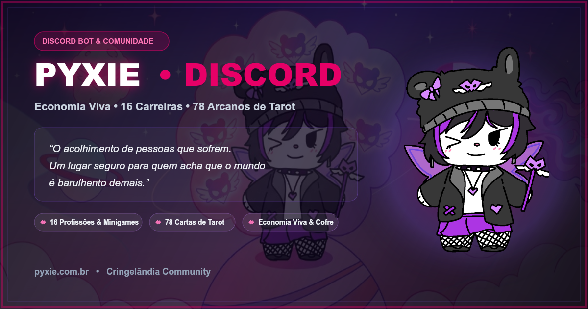
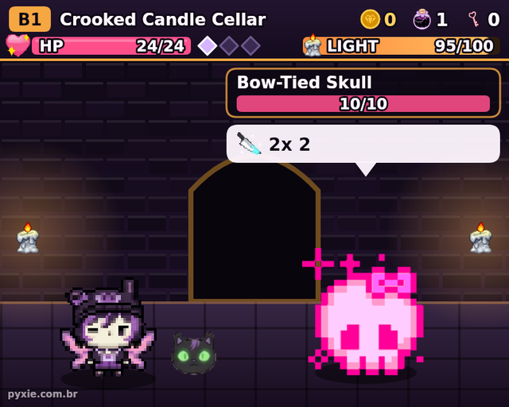
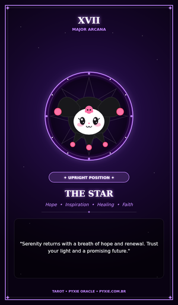

  

<h1 align="center">Pyxie</h1>

  <strong>A cute, slightly grumpy fairy for your Discord server.</strong> 
  Roguelike dungeon, illustrated tarot, a living economy and a welcoming community. 
  <em>Uma fada fofa (e um pouco rabugenta) para o seu servidor no Discord.</em>

  <a href="https://pyxie.com.br/invite?ref=github"><strong>Add to Discord</strong></a> ·
  <a href="https://pyxie.com.br/install?ref=github">Use on your account</a> ·
  <a href="https://pyxie.com.br/?lang=en">Website</a> ·
  <a href="https://pyxie.com.br/discord?ref=github">Support server</a> ·
  <a href="https://pyxie.com.br/vote">Vote on Top.gg</a>

  

**[English](#english)** · **[Português](#português)**

---

## English

  
  

### What Pyxie does

- **Velvet Catacombs (`/py-dungeon`), Cringelândia only:** a long, hard roguelike across 5 procedural floors. Pay a 50-coin ticket, fight by candlelight, pick blessings and decide when to run with the gold. It's played with buttons and works fine on mobile. The Catacombs, weekly boss, Cozy Room, Workshop, Market, Festival and Pyxie Pass live in [Cringelândia](https://pyxie.com.br/discord), Pyxie's home server: join to play them.
- **Illustrated tarot (`/py-tarot`):** a daily card from the 78 arcana with custom art. Each card goes into your album, and every card has its [own meaning page](https://pyxie.com.br/tarot/cartas?lang=en).
- **Living economy:** daily coins and streaks (`/py-daily`), 22 careers with shift minigames (`/py-work`), magic beans, profile themes and rankings.
- **Social:** marriages, compatibility cards (`/py-ship`), profiles and quiz duels.
- **Quick games:** tic-tac-toe, minesweeper, rock-paper-scissors, dice, fortune cookies, "who's most likely to" and anime marathons.
- **A safe place:** Pyxie was built for communities that welcome neurodivergent people and anyone going through a hard time. Support flows are warm and predictable, never sarcastic.
- **Bilingual:** English everywhere, Brazilian Portuguese where your server speaks it. An admin picks the language with one click when Pyxie joins.

### Getting started

1. [Add Pyxie to your server](https://pyxie.com.br/invite?ref=github), or [install it on your account](https://pyxie.com.br/install?ref=github) to use tarot and the album anywhere.
2. Try `/py-daily`, `/py-tarot` and `/py-work`.
3. `/py-help` lists every command.

**Permissions:** the default invite asks only for what Pyxie uses: send messages, embeds, images and reactions; manage its own event messages; create ticket channels; give the welcome auto-role. It does **not** ask for Administrator. If you only want games, economy and tarot, use [`/invite?perms=basic`](https://pyxie.com.br/invite?perms=basic&ref=github) instead. It has no management permissions at all.

**Voting:** each [Top.gg vote](https://pyxie.com.br/vote) gives you 1 magic bean (2 on weekends).

---

## Português

### O que a Pyxie faz

- **Catacumbas de Veludo (`/py-dungeon`), exclusivo da Cringelândia:** roguelike longo e difícil em 5 andares procedurais. Pague o ticket de 50 moedinhas, lute à luz de vela, escolha bênçãos e decida a hora de fugir com o ouro. Tudo por botões, pensado para o celular. Catacumbas, chefe semanal, Casinha, Oficina, Mercado, Festival e Passe da Pyxie moram na [Cringelândia](https://pyxie.com.br/discord), a casa da Pyxie: entre lá para jogar.
- **Tarot ilustrado (`/py-tarot`):** uma carta do dia dos 78 arcanos com arte própria. Cada carta vai para o seu álbum, e todas têm [página de significado](https://pyxie.com.br/tarot/cartas).
- **Economia viva:** moedinhas diárias e sequências (`/py-daily`), 22 carreiras com minigames de expediente (`/py-work`), feijões mágicos, temas de perfil e rankings.
- **Social:** casamentos, cartões de afinidade (`/py-ship`), perfis e duelos de quiz.
- **Jogos rápidos:** jogo da velha, campo minado, jokenpô, dados, biscoito da sorte, "quem é mais provável" e maratona de anime.
- **Um lugar seguro:** a Pyxie nasceu para comunidades que acolhem pessoas neurodivergentes e quem está passando por um momento difícil. Os fluxos de acolhimento são calorosos e previsíveis, sem sarcasmo.
- **Bilíngue:** português do Brasil e inglês. Quando a Pyxie entra, a staff escolhe o idioma com um clique.

### Como começar

1. [Adicione a Pyxie ao servidor](https://pyxie.com.br/invite?ref=github), ou [instale na sua conta](https://pyxie.com.br/install?ref=github) para usar tarot e álbum em qualquer lugar.
2. Experimente `/py-daily`, `/py-tarot` e `/py-work`.
3. O `/py-help` mostra todos os comandos.

**Permissões:** o convite padrão pede só o que a Pyxie usa: enviar mensagens, embeds, imagens e reações; gerenciar as próprias mensagens de evento; criar canais de ticket; entregar o cargo automático de boas-vindas. **Não** pede Administrador. Se você só quer jogos, economia e tarot, use [`/invite?perms=basic`](https://pyxie.com.br/invite?perms=basic&ref=github), que não tem nenhuma permissão de gerenciamento.

**Votos:** cada [voto no Top.gg](https://pyxie.com.br/vote) rende 1 feijão mágico (2 no fim de semana).

---

## For developers · Para desenvolvedores

- **Stack:** Node.js 22, discord.js v14, Express 5, PostgreSQL 16 with Drizzle ORM, and atomic JSON files in `data/`.
- **Tests:** `npm test` (the same suite runs in GitHub Actions).
- **Docs:** the architecture, modules, infrastructure and contribution rules are in [`docs/ARQUITETURA.md`](docs/ARQUITETURA.md), [`docs/GUIA-CRIACAO-MODULOS.md`](docs/GUIA-CRIACAO-MODULOS.md) and [`AGENTS.md`](AGENTS.md).
- **License:** Custom Source-Available. You may read, audit and study the code, and run it privately. Public competing hosting, charging users and commercial derivatives need the author's consent. See [`docs/ARQUITETURA.md`](docs/ARQUITETURA.md#-licença--propriedade-intelectual).
